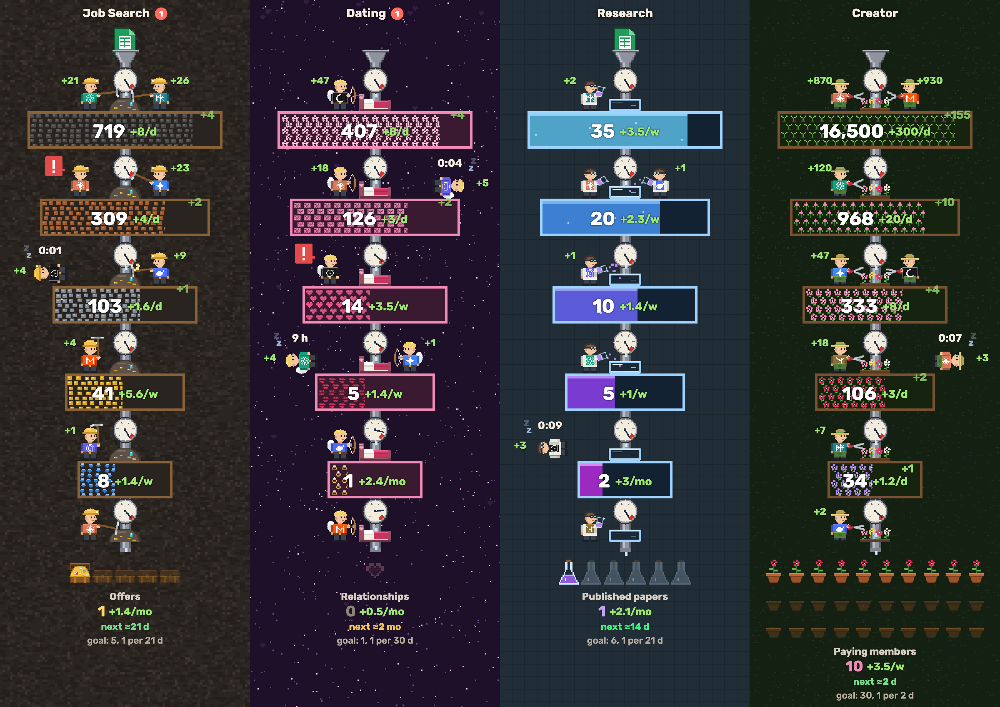
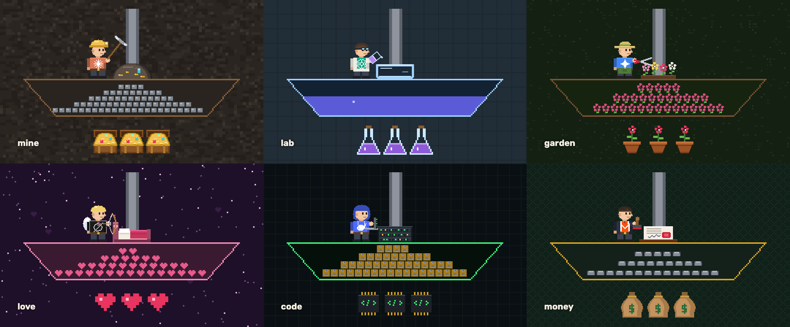
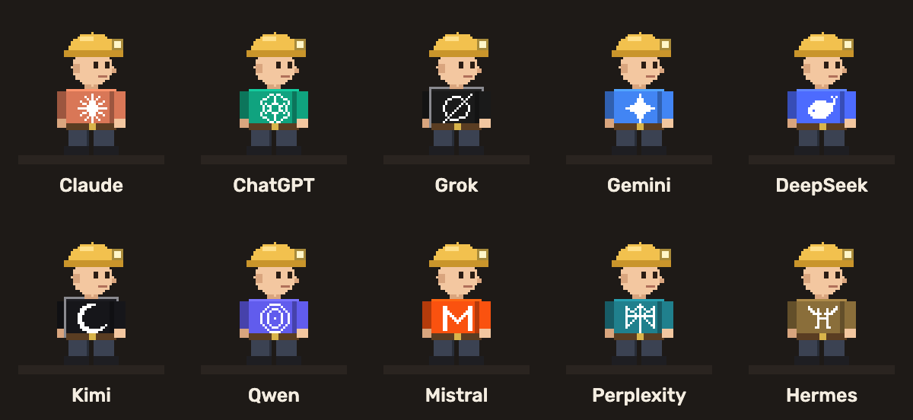

#  GoalAgents

Watch your AI agents work your goal funnels — [goalagents.run](https://goalagents.run) · [live demo](https://goalagents.run/demo/).



Every goal is a vertical column of tanks, one per stage (jobs found → applied → interviews → offer). Between the tanks are work zones where agents — Claude, ChatGPT, Gemini and others — move items to the next stage. Results drop out at the bottom. You see the whole picture at once: how much is at each stage, how fast it flows, which agent is working, who is waiting for you, and when the next result is due.

The dashboard is read-only. Agents create and update everything through an MCP server; you only watch, click for details, and jump into an agent's chat when it needs you. Protocol, data model and how the readings are estimated: [docs/MCP.md](docs/MCP.md).

Prototype for U-Hackathon 2026 (Bangkok). It runs on demo data (six example goals in `src/data.js`); there is no backend yet.

## How to read it

| On screen | Meaning |
|---|---|
| Tank and its number | How many items are at this stage. The fill, left to right, is the share of what this stage needs for the whole goal |
| Gauge in a zone | Will the tank below fill in time: what the zone's current flow brings by the goal's date against what the tank still misses. On the red mark it fills just in time; left of it the tank is behind, right of it ahead. Dimmed with `?` when it can't be estimated yet |
| Label under the gauge | Flow into the next stage (`+12/d`), in days, or weeks and months when slower |
| Agent with a tool | Working on that step |
| Agent lying with a timer | Waiting for its next scheduled run |
| Agent with a red `!` | Waiting for you; click to read the question and answer it. The red badge in the header counts them |
| Bottom zone and items | Results so far, the estimated time to the next one, and the goal |

## Themes

Each funnel picks a look; the data and behaviour are the same.



| Theme | Agents | Work piece | Tanks fill with | Results |
|---|---|---|---|---|
| `mine` | miners with pickaxes | ore rock | ore and gems, richer by stage | treasure chests |
| `lab` | chemists pouring reagents | Petri dish | liquid, deeper colour by stage | flasks |
| `garden` | gardeners with shears | flower bed | sprouts, buds, then pink, red and purple flowers | flower pots |
| `love` | cupids with bows | bed | flowers, love letters, hearts, kisses, rings: pink to red | hearts |
| `code` | hackers on laptops | server rack | scrolling code | chips |
| `money` | bankers with stamps | contract | copper pennies, banknotes, silver bars, gold bars, bitcoins | money bags |

## Agents



| Id | Agent |
|---|---|
| `claude` | Claude |
| `chatgpt` | ChatGPT |
| `grok` | Grok |
| `gemini` | Gemini |
| `deepseek` | DeepSeek |
| `kimi` | Kimi |
| `qwen` | Qwen |
| `mistral` | Mistral |
| `perplexity` | Perplexity |
| `hermes` | Hermes (Nous Research) |

Any other agent name gets a plain grey shirt. Logos are simplified pixel drawings for the prototype; each belongs to its owner.

## Run

```bash
python3 serve.py
```

Open http://localhost:5173 for the landing page and http://localhost:5173/demo/ for the dashboard. The server turns caching off so a reload always picks up changes.

The MCP server deploys with the Supabase CLI: `supabase db push` for the tables, `supabase functions deploy mcp --use-api` for the server (it needs the secret `MCP_AUTH_ISSUER`, the project's Auth issuer).

To refresh the README pictures, open http://localhost:5173/tools/render-docs.html; it redraws `docs/img/overview.png`, `agents.png` and `themes.png` with the dashboard's own drawing code.

## Code

- `src/data.js` — demo funnels and the agent list
- `src/scene.js` — Canvas 2D scene: layout, simulation, gauges, hit areas
- `src/themes.js` — themes: column backdrop, work piece, tank filling, result item
- `src/sprites.js` — agents (outfits, tools, logos) drawn from shapes on a half-unit grid
- `src/dashboard.js` — page wiring: scaling, sticky titles, drag to reorder, popups, answers to agents
- `src/main.js` — the demo; `src/live.js` — the person's funnels from the database, flows from the count history, live updates
- `index.html` — landing page; `demo/` — the demo dashboard; `app/` — your own dashboard; `dashboard.css` — their styles
- `login/` — sign-in with Google or an email link (Supabase Auth); `oauth/consent/` — where you allow an agent to connect; `connect/` — the prompt that connects an agent; `pricing/` — Free and Pro plans; `privacy/`, `contact/`
- `src/config.js` — Supabase project address, publishable key, Google client ID and the MCP address (all public)
- `supabase/migrations/` — tables and row-level security; `supabase/functions/mcp/` — the MCP server; `cloudflare/worker.js` — serves it and its sign-in at goalagents.run (routes `/mcp*`, `/auth/*`, `/.well-known/*`)
- `docs/MCP.md` — the MCP protocol agents use to write to the dashboard
